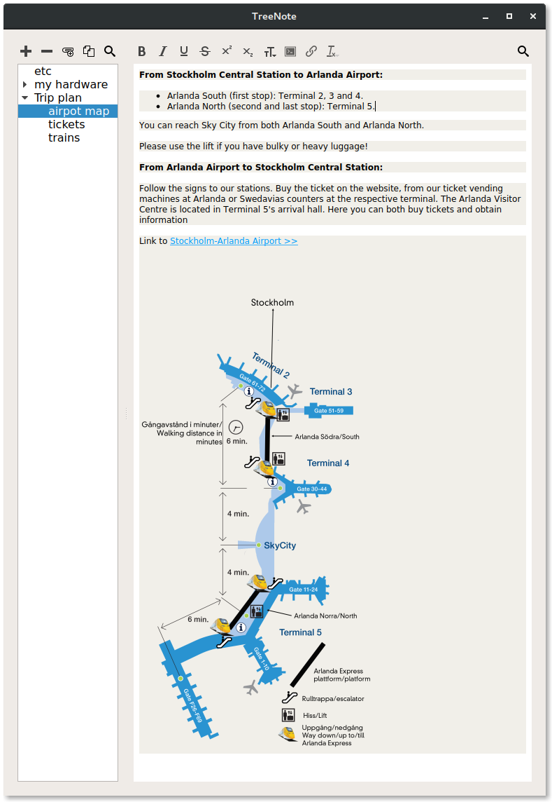

# About

NotesTree is a note taking app, which organizes notes in a hierarchical (tree like) structure.

What makes it different?

* Very simple file structure. Your notes are easily available even without NotesTree installed. They are stored as html files. Just open them in any web browser, including the one on your mobile phone.
* You can store complete web pages, simply by copy-pasting a page into a note. NotesTree automatically downloads all the images, making the note available offline.
* You can attach files of any types to your notes.

 

## Getting it

You can get the wayland only AppImage for x86-64, arm64 and riscv64 at the releases section.

Or launch `./user-install.sh` it will build it inside `docker` and install everything for the current user (no root needed): the binary into `~/.local/bin`, the desktop entry into `~/.local/share/applications` and the icon into `~/.local/share/icons` - Notes Tree then shows up in your application launcher. To uninstall, pick "Uninstall" in the app's launcher menu (or delete those three files).

The docker build (`./docker-build.sh`) needs nothing but docker: it builds a fully static musl binary (plus an AppImage of it) for the host architecture.

